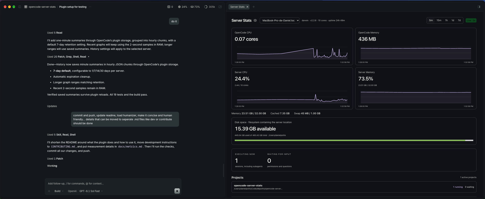

# opencode-server-stats

CPU, memory and disk stats for OpenCode Desktop, with live readings in the session header and a dashboard for history.



Requires OpenCode Desktop 2.2.0 or newer. The GUI API is experimental. Tested on macOS; Linux and Windows still need live testing.

## What it shows

- OpenCode CPU in cores and memory in MB/GB.
- Server CPU and memory percentages, plus cached memory, swap and disk space.
- Running and waiting session counts, grouped by active project.
- Resource graphs from 5 minutes to 30 days, depending on retention.

History stays on each server through OpenCode's plugin storage. Retention defaults to 7 days. There is no external telemetry, and the plugin does not read prompts or message contents.

## Install

Run:

```sh
opencode plugin add opencode-server-stats
```

Or add the package to `plugins` in `~/.config/opencode/opencode.jsonc` (or `opencode.json`), keeping your existing entries:

```jsonc
{
  "$schema": "https://opencode.ai/config.json",
  "plugins": ["opencode-server-stats"]
}
```

Use the global config so Desktop can load the UI. OpenCode installs the package and loads it automatically. If you were testing a local checkout, replace its path in `plugins` with the package name.

To update later:

```sh
opencode plugin update opencode-server-stats
```

## Use

Open a session and click the CPU/memory readings in its header. You can also run `/server-stats` or choose **Server Stats** from the side panel's **+** menu. Drag the tab below the conversation if you want more room.

The cog beside **Server Stats** opens settings. Hide the header readings, choose a refresh interval, turn live updates off, or change history retention. A **Refresh** button appears when live updates are off. Pausing the display does not stop history collection.

Remote servers need the plugin installed too. The dashboard reports the selected server's resources, not your local Desktop's.

## More

- [Development and local setup](CONTRIBUTING.md)
- [What the numbers mean and how history works](docs/metrics.md)
- [MIT license](LICENSE)
